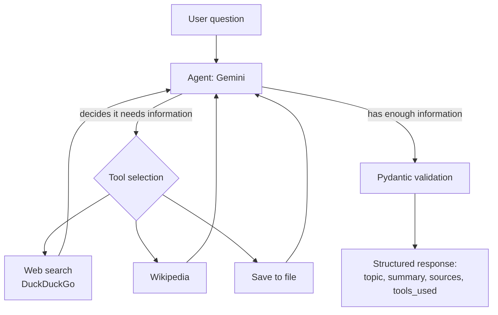

# AI Research Agent

An autonomous research assistant built on Google Gemini and LangChain. Ask it a
question and it decides for itself which tools to use, gathers the information,
and returns a validated, structured answer with its sources.

Available both as a command line application and as a web app.

<!-- Replace the line below with your deployed Streamlit URL once it is live -->
**[Live demo](#)** &nbsp;·&nbsp; **[How it works](#how-it-works)** &nbsp;·&nbsp; **[Design decisions](#design-decisions)**

<!--
  TODO: add a demo recording here. This is the highest value addition to the
  README, since most visitors will not install the project.
  Record the terminal or the web app, save it as docs/demo.gif, then uncomment:


-->

---

## What it does

Given a question such as *"What are the main causes of coral bleaching?"*, the
agent:

1. Decides which of its tools are relevant to the question.
2. Calls them, for example searching the web and reading Wikipedia.
3. Reads the results and decides whether it needs more information.
4. Returns a structured answer: topic, summary, sources, and the tools it used.

The distinction from a plain chatbot is step 1. Nothing in the code says *"for
this question, search Wikipedia"*. The model is given a set of tools and chooses
among them at runtime.

## Features

- **Autonomous tool selection** across web search, Wikipedia, and file export.
- **Structured, validated output.** Every answer is a Pydantic model, not loose
  prose, so the response shape is guaranteed rather than hoped for.
- **Automatic model fallback.** Google's free tier frequently returns
  `503 overloaded`; the agent transparently retries on a backup model instead
  of failing.
- **Two interfaces, one implementation.** The CLI and the web app both import
  the same `agent.py`, so they cannot drift apart.
- **No setup to try it.** The hosted demo needs nothing from the visitor: no
  sign-up, no API key, no install.

## How it works



The loop between the agent and its tools is the important part: the model can
call a tool, read the result, and decide to call another before answering.

## Tech stack

| Layer | Choice |
|---|---|
| Model | Google Gemini (`gemini-3.5-flash`, with fallbacks) |
| Agent framework | LangChain 1.x (`create_agent`) + LangGraph |
| Output validation | Pydantic v2 |
| Tools | DuckDuckGo search, Wikipedia API |
| Web interface | Streamlit |
| Config | python-dotenv |

## Quick start

Requires Python 3.10 or newer.

```bash
# 1. Clone and enter the project
git clone https://github.com/rashmiJayawardhana/ai-agent.git
cd ai-agent

# 2. Create and activate a virtual environment
python -m venv venv
venv\Scripts\activate        # Windows
source venv/bin/activate     # macOS and Linux

# 3. Install dependencies
pip install -r requirements.txt

# 4. Add your API key
cp .env.example .env         # then paste your key into .env
```

Get a free Gemini API key at
[aistudio.google.com/apikey](https://aistudio.google.com/apikey).

Then run either interface:

```bash
python main.py          # command line
streamlit run app.py    # web app at http://localhost:8501
```

## Project structure

```
agent.py            Agent core: model, prompt, tools, structured output
tools.py            Tool definitions (search, Wikipedia, file export)
main.py             Command line interface
app.py              Streamlit web interface
requirements.txt    Pinned dependencies
.env.example        Configuration template
LEARN.md            Annotated walkthrough for those new to AI agents
```

## Design decisions

**The agent core is separate from both interfaces.** `agent.py` exposes a single
`research()` function and knows nothing about terminals or web pages. Progress
is reported through an `on_status` callback, so each interface decides how to
display it. Adding a third interface would require no change to the agent.

**Output is validated, not parsed.** Passing a Pydantic model to
`response_format` means malformed output fails at the boundary rather than
halfway through rendering. The alternative, parsing free-form text with string
operations, breaks the moment a model phrases something differently.

**The web demo asks the visitor for nothing.** An earlier version let visitors
supply their own API key to bypass the shared quota. It was removed: most people
opening a demo link do not know what an API key is, and a field asking for one
reads as the page being broken. The cost of that choice is a shared quota, so
rate and quota limits are caught and shown as plain, calm messages ("this demo
has reached its daily limit") rather than as errors, since neither indicates a
fault the visitor can act on.

**Library-level retries are disabled deliberately.** With `max_retries` left at
its default, an overloaded model does not report an error; it silently retries
with backoff for minutes, which is indistinguishable from a frozen program.
Setting `max_retries=0` surfaces the `503` immediately so the fallback chain can
handle it, and the user sees what is happening.

**Dependencies are pinned.** This project was originally written against
LangChain 0.x, where `create_tool_calling_agent` and `AgentExecutor` were the
entry points. Both were removed in 1.x. Pinning means a future release cannot
break the project for anyone cloning it.

**Wikipedia requests send a descriptive User-Agent.** The `wikipedia` package
ships a generic shared agent string that Wikipedia now rate limits, returning
HTML that surfaces confusingly as a JSON decode error. Setting a specific
User-Agent resolves it.

## Troubleshooting

| Symptom | Cause and fix |
|---|---|
| `Could not resolve authentication method` | `GOOGLE_API_KEY` is missing or empty in `.env`. |
| `503 UNAVAILABLE` on every model | All models busy. Transient on the free tier; retry shortly or add models to `MODELS` in `agent.py`. |
| `404 ... model is no longer available` | Model renamed. Update `MODELS` in `agent.py`; see `LEARN.md` for how to list available models. |
| `ImportError: cannot import name 'create_tool_calling_agent'` | You are on LangChain 1.x following a 0.x tutorial. This project already targets 1.x. |
| `Could not import ddgs` | Run `pip install -U ddgs`. The package was renamed from `duckduckgo-search`. |

New to AI agents? `LEARN.md` is an annotated walkthrough of the same code.

## License

MIT. See [LICENSE](LICENSE).
